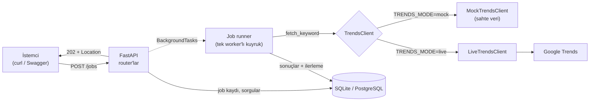

# TrendRadar API

Ürün isimleri için Google Trends'ten **en çok aranan (top)** ve **yükselişteki (rising)** ilişkili aramaları
toplayan, veritabanında saklayan ve bu sonuçlar üzerinde sorgulama ve analiz sunan bir REST API.

FastAPI ile geliştirilmiş bireysel bir ders projesidir. Tek seferlik çalışan bir komut satırı scraper'ının
(`google_trends_scraper`) bir web servisine dönüştürülmüş halidir: CSV dosyaları ve log dosyası yerini
ilişkisel bir veri modeline, elle çalıştırılan döngü yerini arka planda işleyen bir tarama kuyruğuna bıraktı.

## Ne yapar?

1. Bir veya birden çok ürün adı gönderirsiniz (ör. `"Camera Bags"`, `"Backpacks"`); isteğe bağlı olarak ülke ve
   zaman aralığı seçersiniz.
2. API bir tarama işi (job) oluşturur ve hemen `202 Accepted` ile işin adresini döner.
3. Tarama arka planda yürür; ilerlemeyi (`2/3`) sorgulayabilirsiniz.
4. Tamamlanınca sonuçları filtreleyerek alır veya CSV olarak indirirsiniz.
5. Aynı ürün farklı zamanlarda tekrar taranırsa geçmişini ve iki tarama arasındaki farkı (diff) inceleyebilirsiniz.

## Mimari



Öne çıkan tasarım kararları:

- **Asenkron iş deseni.** Tarama dakikalar sürebildiği için HTTP isteği içinde yapılmaz. `POST /jobs` işi
  kuyruğa alıp hemen döner; istemci durumu `GET /jobs/{id}` ile sorgular (polling).
- **Tek worker'lı kuyruk.** Google, tek bir oturumdan gelen paralel isteklere `429` döndüğü için aynı anda
  yalnızca bir tarama çalışır; diğerleri `pending` durumda sırasını bekler. Bu, süreç içi bir kilitle sağlanır.
- **Değiştirilebilir trends client.** Job runner yalnızca `TrendsClient` arayüzünü bilir. Mock ve live client
  aynı arayüzü uygular; hangisinin kullanılacağı açılışta `TRENDS_MODE` ile seçilir.
- **Uygulama fabrikası ve bağımlılık enjeksiyonu.** `create_app(settings, trends_client)` sayesinde testler
  kendi ayarlarını, bellek içi veritabanını ve sahte client'ını verir.
- **Kendini toparlama.** Sunucu bir taramanın ortasında kapanırsa, sonraki açılışta yarım kalan iş `failed`
  olarak işaretlenir ve bekleyen işler kaldığı yerden sürer.

## Kurulum

Gereksinim: Python 3.12 (yerel kurulum) veya Docker.

### Yerel

```bash
git clone https://github.com/yasinharman/TrendRadar.git
cd TrendRadar

python -m venv .venv
source .venv/bin/activate            # Windows: .venv\Scripts\activate
pip install -r requirements-dev.txt

uvicorn app.main:app --reload
```

API `http://127.0.0.1:8000` adresinde açılır; etkileşimli belge (Swagger) `http://127.0.0.1:8000/docs`
adresindedir. Hiçbir ayar yapmadan **mock modda** ve yerel bir SQLite dosyasıyla (`trendradar.db`) çalışır.

Ayarları değiştirmek için `.env.example` dosyasını `.env` adıyla kopyalayıp düzenleyin.

### Docker

```bash
docker compose up --build
```

API ve PostgreSQL birlikte ayağa kalkar; API yine `http://127.0.0.1:8000` adresindedir. Veriler `pgdata`
volume'unda kalıcıdır.

```bash
docker compose down        # durdur (veriler kalır)
docker compose down -v     # durdur ve verileri sil
API_PORT=9000 docker compose up --build   # 8000 doluysa başka portta çalıştır
```

## Çalışma modları

| Mod | `TRENDS_MODE` | Veri kaynağı | Cookie |
|---|---|---|---|
| Mock (varsayılan) | `mock` | Ürün adından türetilen, tutarlı sahte veri | Gerekmez |
| Live | `live` | Gerçek Google Trends | Gerekir |

### Mock mod

Ağ isteği atmaz. Aynı ürün adı her zaman aynı temel sonucu üretir; aynı sunucu oturumunda ürün **tekrar**
taranırsa değerler ±%20 oynar ve listeye birkaç arama girip çıkar. Böylece geçmiş ve diff endpoint'leri gerçek
veri olmadan da anlamlı sonuç gösterir.

Hata senaryolarını denemek için ürün adına işaret kelimesi ekleyin:

| Ürün adında geçen | Sonuç |
|---|---|
| `fail` | O ürün `failed` olur (genel tarama hatası) |
| `empty` | O ürün `failed` olur (Google boş veri döndü) |

Bir işte hem başarılı hem başarısız ürün varsa iş `partial`, hiç başarılı ürün yoksa `failed` olur.

### Live mod

Google Trends'in arka uç API'leri oturum cookie'si ister.

1. Tarayıcıda Google hesabınızla `trends.google.com` adresini açın.
2. Cookie'leri bir eklentiyle (Cookie-Editor, EditThisCookie) JSON olarak dışa aktarın ve proje köküne
   `cookies.json` adıyla kaydedin.
3. `.env` dosyasında `TRENDS_MODE=live` yapın ve sunucuyu başlatın.

Cookie dosyası yoksa veya geçersizse uygulama açıklayıcı bir hata mesajıyla **başlamaz**.

Live modda her ürün yaklaşık 10–25 saniye sürer (Google'ın hız sınırına takılmamak için istekler arasında
rastgele beklenir); `429` yanıtında 30 ve 60 saniye beklenip tekrar denenir.

> **Güvenlik uyarısı.** `cookies.json` Google hesabınızın oturumunu içerir; ele geçiren kişi hesabınıza
> erişebilir. Bu dosyayı **asla commit etmeyin, paylaşmayın veya loglamayın.** Dosya `.gitignore` ve
> `.dockerignore` içindedir; Docker'da imaja kopyalanmaz, yalnızca salt-okunur volume olarak bağlanır
> (`docker-compose.yml` içindeki örneğe bakın).

## Endpoint'ler

| Metot | Yol | Açıklama |
|---|---|---|
| `GET` | `/health` | Servis, veritabanı ve kuyruk durumu |
| `POST` | `/jobs` | Yeni tarama başlat (`202` + `Location`) |
| `GET` | `/jobs` | İşleri listele (`status`, `limit`, `offset`) |
| `GET` | `/jobs/{id}` | İş detayı, ilerleme ve ürün bazında özet |
| `DELETE` | `/jobs/{id}` | İşi sil (çalışan iş silinemez: `409`) |
| `GET` | `/jobs/{id}/results` | Sonuçlar (`type`, `keyword`, `min_value`, `breakout_only`, `search`) |
| `GET` | `/jobs/{id}/export.csv` | Sonuçları Excel uyumlu CSV olarak indir |
| `GET` | `/keywords/{keyword}/history` | Bir ürünün tarama geçmişi |
| `GET` | `/insights/breakouts` | Tüm taramalardaki breakout aramalar |
| `GET` | `/insights/diff` | İki tarama arasındaki fark |

Tüm parametreler, yanıt örnekleri ve hata kodları Swagger arayüzünde (`/docs`) belgelidir.

Genel kurallar:

- Listeleme endpoint'leri `{"items": [...], "total": 123, "limit": 50, "offset": 0}` zarfıyla döner.
- Zaman damgaları ISO 8601 biçiminde ve UTC'dir (`2026-11-23T13:30:00Z`).
- Hatalar `{"detail": "..."}` biçimindedir. Doğrulama hatalarında (`422`) `detail`, hatalı alanı gösteren bir
  listedir.
- **Breakout:** yükselişi `BREAKOUT_THRESHOLD` (varsayılan %5000) ve üzerinde olan rising arama.

## Örnek akış

Sunucu çalışırken aşağıdaki akışın tamamını tek komutla deneyebilirsiniz:

```bash
scripts/demo.sh
```

Adım adım:

```bash
# 1) Tarama başlat — hemen 202 ve Location header'ı döner
curl -i -X POST http://127.0.0.1:8000/jobs \
  -H 'Content-Type: application/json' \
  -d '{"keywords": ["Camera Bags", "Backpacks"], "geo": "TR", "timeframe": "today 1-m"}'

# 2) Durumu izle — status: pending → running → completed, progress: 0/2 → 2/2
curl http://127.0.0.1:8000/jobs/1

# 3) Sonuçları filtrele — yalnızca breakout sayılan rising aramalar
curl "http://127.0.0.1:8000/jobs/1/results?type=rising&breakout_only=true"

# 4) CSV indir
curl -OJ http://127.0.0.1:8000/jobs/1/export.csv

# 5) Aynı ürünü tekrar tara
curl -X POST http://127.0.0.1:8000/jobs \
  -H 'Content-Type: application/json' \
  -d '{"keywords": ["Camera Bags"], "geo": "TR"}'

# 6) İki tarama arasındaki fark: yeni giren, çıkan ve değişen aramalar
curl "http://127.0.0.1:8000/insights/diff?from_job=1&to_job=2"

# 7) Ürünün geçmişi ve tüm breakout'lar
curl "http://127.0.0.1:8000/keywords/Camera%20Bags/history"
curl "http://127.0.0.1:8000/insights/breakouts?limit=5"
```

## Yapılandırma

Ayarlar ortam değişkenlerinden veya `.env` dosyasından okunur; tamamı açıklamalarıyla `.env.example`
dosyasındadır. En sık değiştirilenler:

| Ayar | Varsayılan | Açıklama |
|---|---|---|
| `TRENDS_MODE` | `mock` | `mock` veya `live` |
| `DATABASE_URL` | `sqlite:///./trendradar.db` | Docker'da `postgresql+psycopg://...` |
| `DEFAULT_GEO` | *(boş)* | İstekte ülke verilmezse kullanılır; boş = tüm dünya |
| `DEFAULT_TIMEFRAME` | `today 1-m` | `now 7-d`, `today 1-m`, `today 3-m`, `today 12-m`, `today 5-y` |
| `BREAKOUT_THRESHOLD` | `5000` | Rising değeri bu eşik ve üzerindeyse breakout sayılır |
| `MAX_KEYWORDS_PER_JOB` | `30` | Tek taramadaki en fazla ürün sayısı |
| `MOCK_DELAY_SECONDS` | `0.5` | Mock modda ürün başına bekleme; ilerlemeyi izlemek için artırılabilir |

## Testler

```bash
pytest                # tüm testler
pytest --cov=app      # kapsam raporuyla
```

Testler **asla gerçek Google'a istek atmaz**: uygulama mock client ve bellek içi SQLite ile kurulur; live
client'ın ayrıştırma ve yeniden deneme mantığı ise elle hazırlanmış örnek yanıtlar (`tests/fixtures/`) ve
sahte bir HTTP oturumuyla sınanır.

| Dosya | Kapsam |
|---|---|
| `test_jobs.py` | İş oluşturma, doğrulama, listeleme, detay, silme |
| `test_job_runner.py` | Durum kuralları, ilerleme, sıralı işleme, kilit, açılışta kurtarma |
| `test_results.py` | Sonuç filtreleri, sayfalama, CSV |
| `test_insights.py` | Diff, breakout listesi, tarama geçmişi |
| `test_live_client_parsing.py` | Google yanıtlarının ayrıştırılması, `429` ve ağ hatalarında yeniden deneme |
| `test_mock_client.py` | Mock verinin tutarlılığı ve tekrar taramalardaki oynama |
| `test_error_codes.py`, `test_openapi.py` | Her endpoint'in hata kodları ve Swagger belgesinin eksiksizliği |
| `test_config.py`, `test_models.py`, `test_health.py`, `test_startup.py` | Ayarlar, veri modeli, sağlık kontrolü, mod seçimi |

## Proje yapısı

```
app/
├── main.py                  # create_app() fabrikası, açılış/kapanış, router kaydı
├── dependencies.py          # Oturum, ayar, client ve sayfalama bağımlılıkları
├── core/config.py           # Settings (pydantic-settings)
├── db/
│   ├── models.py            # ScrapeJob → JobKeyword → QueryResult
│   └── session.py           # Engine oluşturma, tabloların hazırlanması
├── schemas/                 # İstek ve yanıt şemaları
├── routers/                 # health, jobs, keywords, insights
└── services/
    ├── job_runner.py        # Kuyruk ve tarama yürütme
    ├── insights.py          # Diff, breakout ve geçmiş sorguları
    └── trends/              # TrendsClient arayüzü, live ve mock client
tests/                       # pytest testleri ve örnek Google yanıtları
scripts/demo.sh              # Uçtan uca demo akışı
legacy/                      # API'ye dönüştürülen özgün scraper
```

## Bilinen sınırlar

- **Kimlik doğrulama yok.** API'yi herkese açık bir adreste yayınlamayın; Docker kurulumu bu yüzden portu yalnızca
  `127.0.0.1` üzerinde açar.
- **Tek süreç.** Tarama kuyruğunun kilidi süreç içinde olduğu için uygulama tek worker ile çalıştırılmalıdır
  (`uvicorn --workers` kullanmayın).
- **Taramalar yalnızca elle başlatılır.** Zamanlanmış (periyodik) tarama yoktur.
- **Kapatma, süren taramayı bekler.** Tarama sürerken `Ctrl+C` ile kapatırsanız sunucu kuyruğun bitmesini bekler;
  ikinci `Ctrl+C` hemen kapatır ve yarım kalan iş sonraki açılışta `failed` olarak işaretlenir.
- **Mock veride oynama oturuma bağlıdır.** Sunucu yeniden başlatıldığında bir ürünün ilk taraması yine temel
  sonucu verir.
- **Live mod otomatik testlerle doğrulanamaz.** Google'ın arka uç API'leri belgelenmemiştir ve haber vermeden
  değişebilir.

## Lisans

[MIT](LICENSE)
